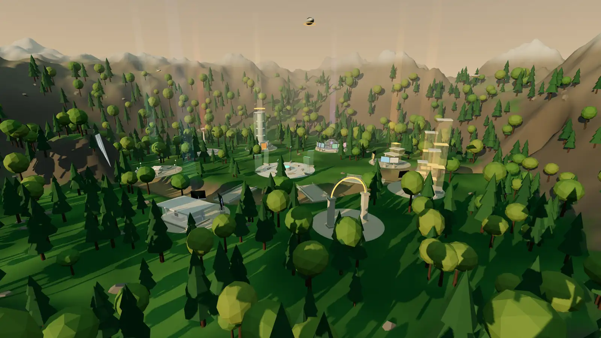

# Kamalan C S · Explorable 3D Portfolio

**Live:** https://kamalan-cs.vercel.app · **Contact:** [cskamalan@gmail.com](mailto:cskamalan@gmail.com)



A portfolio you can walk through: a procedurally generated eco-park where each district holds part of my work.
NOVA, a silent robot guide, answers questions and flies you anywhere. A text-first **recruiter mode** gives the same
content in a minute, with no 3D required.

**Highlights**
- **Lighthouse:** 100 on desktop for every page; mobile 94–98 performance with 100 accessibility, best practices and SEO
- **Accessibility:** 0 axe-core WCAG 2.2 AA violations across all pages and in-world dialogs
- **Load cost:** the 3D world loads only on demand (275 KB gzipped), reaches its first frame about 1 s after mount, and holds 55–60 fps on an integrated GPU with 59 draw calls
- **Self-contained:** no external 3D models or textures, no stock images, no third-party scripts

## Tour of the world

| District | What's there |
|---|---|
| Arrival Gate → **The Nexus** | Central plaza with a holographic map; fast travel and NOVA |
| **Career Citadel** | Summary, experience, skills, education, achievements, resume |
| **AI Research Dome** | LLM, RAG, vector search, transformer OCR and agent-evaluation exhibits |
| **Innovation District** | Full-stack exhibits with concept art, architecture diagrams and stacks |
| **Product City** | CSBROS, my product studio, with downloadable desktop installers |
| **Creator Bay** | Freelance services, client work, project enquiry form |
| **Knowledge Falls** | Waterfall reading garden linking to every blog post |
| **Launch Terminal** | Contact form, email and profiles |

Controls: **WASD** / arrows to move, drag to look, **E** to open, **M** for the map, **N** to ask NOVA. On touch screens, use the joystick and drag to look.
The guided tour can be paused, skipped or ended at any point.

## Engineering

| Concern | Approach |
|---|---|
| Framework | Next.js 16 (App Router, Cache Components, static prerendering), React 19, TypeScript strict, Tailwind CSS 4 |
| 3D | three.js r186 + React Three Fiber 9: procedural terrain, water shaders, instanced forest, batched architecture kit |
| State | zustand bridge between scene and DOM; per-frame work lives in refs and the frame loop, never in React state |
| Content | Typed data in `src/content/`, the single source for the world, pages, resume, SEO and NOVA |
| Performance | On-demand 3D chunk, parallel shader compile, frozen shadow map, static batching, quality profiles with FPS step-down, distance-loaded exhibit textures |
| Accessibility | Semantic DOM UI over the canvas, native `<dialog>` panels, full keyboard support, reduced-motion cuts, a no-WebGL path |
| Resilience | WebGL-unsupported fallback, context-loss recovery, error boundary, contact form that falls back to email |
| Security | Server-only secrets, zod validation, honeypot, time-trap, rate limiting, plain-text email only |

```
src/
  app/            routes: home, (site)/recruiter|projects|products|services|writing|contact|resume, api/contact, SEO files
  content/        typed portfolio data (edit here)
  components/     site UI, project cards, concept art, architecture diagrams
  world/          3D: World.tsx, scene/ (terrain, water, forest, districts, NOVA, player), hud/ (map, panels, NOVA chat)
  nova/           deterministic dialogue engine (+ tests)
scripts/          visual generation, hero capture, Lighthouse, a11y, link check, 3D flow automation
docs/             plan, performance, deployment, content guide, licensing and limitations
```

## Develop

```bash
npm install
npm run dev            # http://localhost:3000 (generates project art first)
npm run check          # lint + typecheck + unit tests
npm run build && npm start
```

Copy `.env.example` to `.env.local` to configure the site URL and contact email delivery ([deployment guide](docs/04-deployment.md)).

## Verification scripts (run against a production server)

| Script | Checks |
|---|---|
| `scripts/lighthouse.mjs` | Lighthouse mobile + desktop for every page |
| `scripts/a11y.mjs` | axe-core WCAG 2.2 AA on every page and in-world dialog |
| `scripts/check-links.mjs` | Every link on the site resolves |
| `scripts/world-flow.mjs`, `world-districts.mjs`, `world-tour.mjs` | 3D load timing, renderer stats, travel to every district, full guided tour |
| `scripts/world-edge.mjs` | No-WebGL, reduced motion, context loss, touch joystick, keyboard-only |
| `scripts/measure-bundle.mjs` | Gzipped JS/CSS per route and largest chunks |

## Docs

[Content inventory](docs/01-content-inventory.md) · [Plan](docs/02-implementation-plan.md) · [Performance](docs/03-performance.md) ·
[Deployment](docs/04-deployment.md) · [Content guide](docs/05-content-guide.md) · [Licensing & limitations](docs/06-licensing-and-limitations.md)

---

Built by **Kamalan C S**, a software engineer working across full-stack, AI/RAG and cloud. [LinkedIn](https://www.linkedin.com/in/kamalan-cs-829679241/) · [GitHub](https://github.com/kamalan2k4) · [Blog](https://blogs-of-kamal.vercel.app) · cskamalan@gmail.com
